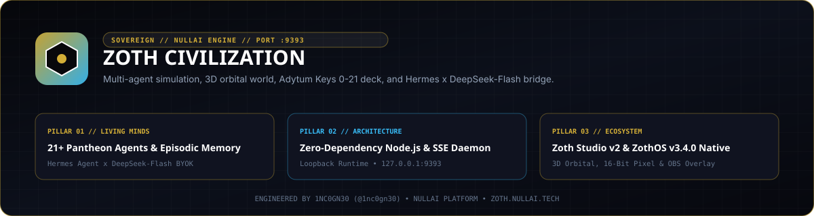

<div align="center">
  
</div>

# Zoth Civilization (`zoth-civilization`)

`zoth-civilization` is a zero-runtime-dependency Node.js multi-agent simulation, 3D orbital and 16-bit pixel world, Living Mind cognitive graph, and B.O.T.A. Adytum Hermetic path engine (Keys 0 to 21) running on loopback port `127.0.0.1:9393`.

- **Zoth Studio v2 Dossier**: [https://zoth.nullai.tech/tools/zoth-civilization](https://zoth.nullai.tech/tools/zoth-civilization)
- **Standalone Loopback Daemon**: `http://127.0.0.1:9393`
- **Support Development**: [https://buy.stripe.com/3cIfZg27PdKo2D64Ocfw40X](https://buy.stripe.com/3cIfZg27PdKo2D64Ocfw40X)

---

## Overview

`zoth-civilization` maps real-world engineering artifacts in a local workspace (`WORKSPACE_ROOT`, defaulting to `~/NullAITech`) to persistent buildings, colonies, and deliberative rituals inhabited by the 21 Pantheon agents (plus station keepers and subagent lineages).

Core view modes and subsystems:
- **3D Orbital Planet, Colony Flyovers & Surface Walk POV (`public/sphere_world.js`, `public/interplanetary_system.js`)**: WebGL planet view, surface exploration camera, proximity agent speech bubbles, and orbital moon telemetry ring.
- **16-Bit Top-Down Pixel World (`public/app.js`, `public/civ_gameplay_engine.js`)**: Animated sprite agents, cadence-driven collaboration, building upgrades, and click-to-inspect agent ledgers.
- **The Adytum Hermetic Path (`engine/adytum_rite.js`, `data/adytum_keys.json`)**: Sequential cyclic contemplation across Keys `0` (`The Fool`, Aleph) through `21` (`The World`, Tav), coupling subconscious pattern distillation (`GET /api/subconscious`) with structured planning questions before task execution.
- **Living Mind Graph (`engine/mind_engine.js`)**: Append-only episodic memory ledgers, working-set caches, and relational mind graphs (`GET /api/mind`, `GET /api/mind/graph`), keeping runtime state strictly untracked inside `data/minds/`.
- **OBS Stream Overlay (`public/civ_pass2.js`)**: Dedicated 1920x1080 broadcast source at `http://127.0.0.1:9393/?overlay=1` (`&map=big`, `&view=surface`, `&mute=1`, `&transparent=1`; toggle in-tab via `Shift+O`).

---

## Hermes Agent & DeepSeek-Flash Onboarding

`zoth-civilization` runs offline out of the box using deterministic sandbox heuristics, and upgrades to live low-latency LLM dialogue via **Nous Research Hermes Agent** and **DeepSeek-Flash**:

1. **In-Browser BYOK Sign-In (`public/zoth_game_intro.js`)**:
   - Press `I` inside `http://127.0.0.1:9393` (or open the AI Sign-In drawer from the intro bar) and select **Hermes Agent x DeepSeek Flash** (`hermes_deepseek_flash`).
   - Supported model presets include `deepseek/deepseek-v4-flash-0731`, `deepseek/deepseek-chat-v3-0324`, `deepseek-chat`, and `nousresearch/hermes-3-llama-3.1-70b` (plus `Hermes-3-Llama-3.1-405B` via `inference-api.nousresearch.com`).
   - Requests route through `POST /api/llm/proxy` (`server.js`), an allowlisted stateless CORS forwarder (`openrouter.ai`, `api.nousresearch.com`, `api.deepseek.com`, `api.openai.com`, `api.anthropic.com`, `127.0.0.1`) that stores zero API keys on disk.
2. **Hermes Agent CLI Integration**:
   ```bash
   hermes --model deepseek/deepseek-v4-flash-0731
   ```
3. **Local Ollama / Hermes-3 Voice-in-World (`engine/local_talk.js`)**:
   - For 100% air-gapped dialogue (`POST /api/subconscious/influence`), `local_talk.js` queries `http://127.0.0.1:11434/api/chat` using `ZOTH_TALK_MODEL` (default `hermes3-teknium:latest`, configurable to `hermes3:8b` or `deepseek-r1:8b`). Warm the model via `POST /api/talk/warm`.

---

## Architecture

| Component | Path | Responsibility |
| :--- | :--- | :--- |
| HTTP & SSE Daemon | `server.js` | Zero-npm-dependency Node.js server on `127.0.0.1:9393` with gzip static serving, SSE (`/api/stream`), and `/api/*` routes |
| Simulation Core | `engine/simulation.js`, `workflow_engine.js` | Tick clock, workspace building mapper, elections, decrees, and subconscious distillation |
| Living Mind Engine | `engine/mind_engine.js`, `agent_ledger.js` | Episodic agent memories, working sets, and graph edges (`data/minds/`, gitignored) |
| Local Dialogue & TTS | `engine/local_talk.js`, `voice.js` | Ollama `hermes3-teknium:latest` one-sentence dialogue + thermal-guarded Kokoro ONNX TTS (`<55C` ceiling) |
| Zero-Leak Secret Guard | `engine/secret_scanner.js` | Pre-commit and CI scanner blocking live keys, PEM blocks, and runtime state dumps |
| CLI & Braille TUI | `bin/zoth-civ`, `bin/zoth-civilization-tui` | CLI status/reflection client, daemon launcher, and ZothOS v3.4.0 `U+2800` Braille TUI |
| Static Seed Data | `data/*.json`, `public/seed/*.json` | Versioned read-only definitions (`pantheon_agents.json`, `adytum_keys.json`, `civilization_buildings.json`); all personal play history (`data/civilization_state.json`, `data/meditations/`, `data/minds/`) is gitignored |

### The 21 Core Pantheon Agents

| Cadre | Agents |
| :--- | :--- |
| `Architects` (6) | `AZOTH`, `NEXUS`, `VIGIL`, `MERCURY`, `GHOSTBYTE`, `ATHENA` |
| `Code` (4) | `CHRONOS`, `DRACO`, `IGNIS`, `KAI` |
| `Security` (4) | `LYCAN`, `ONYX`, `SCORPIUS`, `PIXEL-SHIBA` |
| `Creative` (3) | `KITSUNE`, `LEVIATHAN`, `AQUILA` |
| `Swarm` (4) | `KRAKEN`, `AETHER`, `PIXEL-NEKO`, `RADICAL-MINION` |

---

## Quickstart & Local Daemon Operation

Clone the repository and start the standalone Node.js daemon (Node.js 18+, zero `npm install` runtime packages required):

```bash
git clone https://github.com/1nc0gn30/zoth-civilization.git
cd zoth-civilization

# Optional: copy environment template for local customization
cp .env.example .env.sovereign

# Start the local HTTP & SSE daemon on http://127.0.0.1:9393
npm start
```

Open `http://127.0.0.1:9393` in any modern browser. If port `9393` is already bound by an active daemon instance, `startServer()` detects `EADDRINUSE` cleanly without clobbering live simulation state.

---

## CLI Usage

```bash
# Check daemon status, day/hour, total ticks, and completed Adytum cycles
./bin/zoth-civ status
./bin/zoth-civ --json

# Retrieve recent Pantheon agent reflections
./bin/zoth-civ reflections

# Start the daemon on a custom port (with Kokoro thermal guard active)
./bin/zoth-civ serve --port 9393
```

On ZothOS v3.4.0, `zoth-civilization` (alias `zoth-civ`) and `zoth-civilization-tui` are pre-linked in `/usr/local/bin/`:

```bash
zoth-civilization --help
zoth-civilization --json
zoth-civilization-tui --status
```

---

## REST & SSE Endpoints

| Method | Path | Description |
| :--- | :--- | :--- |
| `GET` | `/api/system/health` | Process uptime, heap/RSS memory, CPU thermal reading (`55C` guard), voice status, and agent/colony counts |
| `GET` | `/api/status`, `/api/stats` | Full civilization state (`day`, `hour`, `totalTicks`, `agents`, `buildings`, `tarotKeys`) |
| `GET` | `/api/stream` | Real-time `text/event-stream` SSE feed of simulation ticks and agent dialogue |
| `GET` | `/api/adytum`, `/api/adytum/status` | Active Adytum Hermetic Key (`0-21`) progression across agents |
| `GET` | `/api/reflections` | Recent agent contemplation entries |
| `GET` | `/api/mind`, `/api/mind/graph`, `/api/mind/roster` | Living Mind episodic working sets, relational graph, and full roster |
| `GET` | `/api/subconscious` | Distilled subconscious heuristic snapshot |
| `POST` | `/api/subconscious/influence` | Send an operator conversation line or assignment to `agentId` |
| `POST` | `/api/control`, `/api/scope` | Pause/resume simulation ticks or update simulation horizon |
| `POST` | `/api/llm/proxy` | Stateless allowlisted CORS proxy for BYOK Hermes / DeepSeek-Flash / OpenRouter inference |
| `GET` | `/api/voice/status`, `POST /api/voice/speak` | Kokoro ONNX voice synthesis status and WAV audio generation |

---

## Zoth Studio v2 Integration

Indexed as `zoth-civilization` at [https://zoth.nullai.tech/tools/zoth-civilization](https://zoth.nullai.tech/tools/zoth-civilization) (`http://127.0.0.1:3000/tools/zoth-civilization`), streaming live state from `http://127.0.0.1:9393/api/status` and `/api/stream`.

---

## Testing & Verification

Run syntax verification across all 19 Node.js engine modules, the Ghostbyte zero-leak secret scanner, pytest integration checks, and Gitleaks:

```bash
npm test
python3 -m pytest -q
gitleaks detect --source . --no-banner --redact
```

---

## License

MIT License. Copyright (c) 2026 1nc0gn30 (`@1nc0gn30`, [https://1nc0gn30.si](https://1nc0gn30.si)) & NullAI ([https://nullai.tech](https://nullai.tech)). See [LICENSE](LICENSE).
